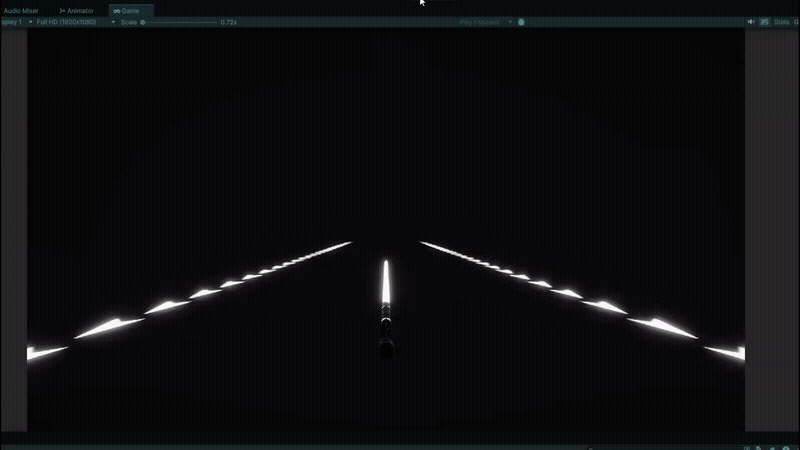

# Pico Saber

A DIY sword controller for a Beat Saber-style Unity game, built with a **Raspberry Pi Pico** and an **MPU6050** motion sensor. Swing the physical sword and the in-game saber follows. No VR headset required.

Built as a university project for a *Systems Programming* course.



## How it works

```
+-------------------+
|      MPU6050      |
|  accel + gyro     |
+-------------------+
          |
          | I2C
          v
+-------------------+
| Raspberry Pi Pico |
|     (firmware)    |
+-------------------+
          |
          | USB serial, 115200 baud
          | "ax,ay,az,gx,gy,gz"
          v
+-------------------+
| SerialDataReceiver|  background thread
+-------------------+
          |
          v
+-------------------+
|       Saber       |  sensor data -> sword motion
+-------------------+
          |
          v
+-------------------+
|        Box        |  targets sliced on contact
+-------------------+
```

- **`SerialDataReceiver`** reads and parses serial lines on a background thread, so I/O never blocks the frame rate.
- **`Saber`** integrates gyro data into rotation and accel data into a small clamped position offset. Sensor axes are remappable in the Inspector, and `C` recalibrates.
- **`Box`** flies toward the player and shatters when it touches the `Sword`.

## Hardware

- Raspberry Pi Pico
- MPU6050 (accelerometer + gyroscope), wired over I2C
- Breadboard and jumper wires

## Known limitations

- Gyro integration drifts over time, so periodic recalibration is needed. A complementary or Madgwick filter would fix this.
- The prototype lives on a breadboard.

## Tech stack

Raspberry Pi Pico · MPU6050 · I2C · USB Serial · Unity · C#
